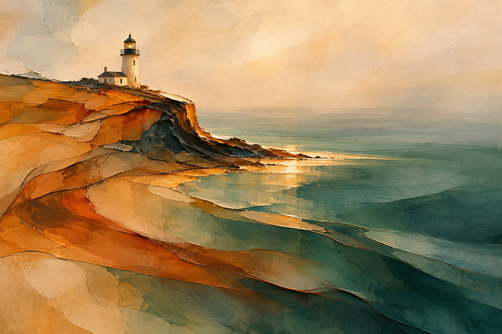
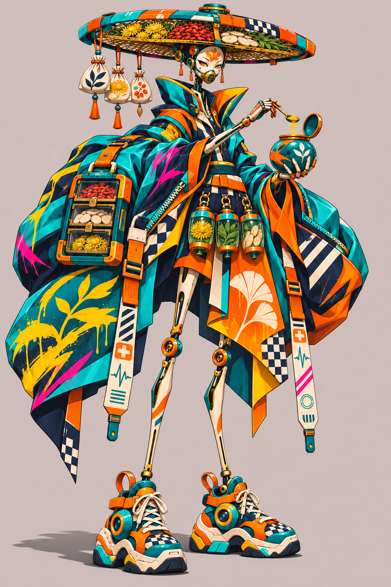

# Visual Style Lab

视觉风格 Skill 集合，用于图片风格转换与角色设计。在支持图像生成的客户端中加载对应 Skill，按示例调用。

## [Form into Flow](skills/form-into-flow/SKILL.md)

保留原图的识别特征与配色，将形体融入流动色层、细线与留白，转成抽象绘画。



```text
用 $form-into-flow 将这张图片转成流动抽象绘画，保留主体识别特征和原图配色。
```

## [东方潮流幻想角色设计](skills/eastern-street-fantasy/SKILL.md)

融合东方宽袍、街头图案与修长机械肢体，以鲜明色块塑造角色。



```text
用 $eastern-street-fantasy 设计一位旧城区机械药师，青绿与橙黄配色，宽袍搭配运动鞋。
```
